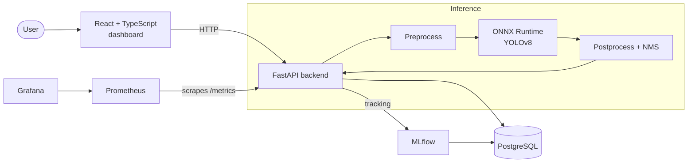

<div align="center">

# 🛰️ EdgeVision

**Aerial small-object detection, benchmarked honestly for the edge.**

YOLOv8 · ONNX (FP32 / FP16 / INT8) · FastAPI · React + TypeScript · PostgreSQL · MLflow · Prometheus

[](LICENSE)


</div>

---

## Why this project exists

A model that scores well on a workstation GPU often falls apart on a resource-constrained device: lower FPS, unstable latency, higher memory use, and small, distant objects slipping through. This is especially true for drone imagery.

EdgeVision is an engineering study of that gap. Instead of only chasing mAP on [VisDrone](https://github.com/VisDrone/VisDrone-Dataset), it measures **accuracy, latency, FPS, and model size together**, across model variants and numeric precisions, and reports negative results too.

## ✨ Highlights

| | |
|---|---|
| 🎯 **Detection** | YOLOv8n / YOLOv8s trained on VisDrone |
| ⚙️ **Export & quantization** | PyTorch → ONNX FP32, FP16 and INT8 (dynamic) |
| 📊 **Benchmarking** | mAP50, FPS, latency and memory per format, plus class-level and lighting-condition analysis |
| 🌐 **Web dashboard** | Upload an image, see boxes drawn on a canvas, browse benchmark tables |
| 🔌 **REST API** | FastAPI service with interactive docs and a health endpoint |
| 🧪 **MLOps stack** | PostgreSQL + MLflow for experiment tracking |
| 📈 **Observability** | Prometheus `/metrics` endpoint and a Grafana dashboard |
| 🐳 **One-command deploy** | Docker Compose for the whole stack |

## 🚀 Quick start

**Requirements:** Git, Docker with Compose, and Python 3 (only for the model download script).

```bash
# 1. Clone
git clone https://github.com/almina-nur/EdgeVision.git
cd EdgeVision

# 2. Download trained models from the v0.1.0 release
python download_models.py

# 3. Launch everything
docker compose up --build --wait
```

| Service | URL |
|---|---|
| Dashboard | http://localhost:3000 |
| API | http://localhost:8000 |
| API docs (Swagger) | http://localhost:8000/docs |
| Health | http://localhost:8000/health |
| Metrics | http://localhost:8000/metrics |
| MLflow | http://localhost:5000 |
| Prometheus | http://localhost:9090 |
| Grafana | http://localhost:3001 |

Enter the API key in the dashboard before running a detection. For local development, the Compose default is `edgevision-secret-key`. Set `EDGEVISION_API_KEY` in your environment or `.env` file to use a different key.

Stop with `docker compose down` (add `-v` to also delete volumes).

<details>
<summary><b>Configuration</b></summary>

| Variable | Purpose | Default |
|---|---|---|
| `MODEL_PATH` | ONNX model served by the API | `models/yolov8n_fp32.onnx` |
| `DATABASE_URL` | PostgreSQL connection string used by the API | The local Compose PostgreSQL service |
| `EDGEVISION_API_KEY` | API key passed to the backend by Compose | `edgevision-secret-key` |

To download the VisDrone dataset as well: `python download_models.py --all`

</details>

## 📊 Results

> ⚠️ **Read this first.** All speed numbers come from a **single-thread CPU simulation**, not from Jetson Orin Nano hardware. They show *relative* behavior between formats, not absolute edge performance. Hardware validation is on the [roadmap](#-roadmap).

<table>
<tr>
<td width="50%"></td>
<td width="50%"></td>
</tr>
</table>

| Model | Format | Size (MB) | mAP50 | FPS (CPU) | FPS (1 thread) |
|---|---|---:|---:|---:|---:|
| YOLOv8n | PyTorch | 6.18 | 0.2754 | – | – |
| YOLOv8n | ONNX FP32 | 12.19 | 0.2658 | 7.25 | 4.66 |
| YOLOv8n | ONNX FP16 | 6.13 | 0.2655 | 8.93 | 9.04 |
| YOLOv8n | ONNX INT8 | 3.32 | 0.2545 | 1.23 | 1.29 |
| YOLOv8s | PyTorch | 21.46 | 0.3555 | – | – |
| YOLOv8s | ONNX FP32 | 42.69 | 0.3523 | 2.81 | 2.62 |
| YOLOv8s | ONNX FP16 | 21.38 | 0.3491 | 2.82 | – |
| YOLOv8s | ONNX INT8 | 10.96 | 0.3401 | 0.43 | 0.45 |

### What we learned (and what needs further validation)

1. **FP16 vs FP32 is nuanced on CPU.** While initial 1-thread tests showed a promising 2x speedup for YOLOv8n FP16, this result varies significantly across model sizes (e.g., YOLOv8s showed no speedup). This suggests potential measurement noise or architectural limitations in CPU-side FP16 execution (ONNX Runtime often casts FP16 back to FP32). Rigorous validation (n=30+, p95/p99 latency) is required before drawing firm conclusions. True FP16 gains are expected on GPU/TensorRT.
2. **INT8 requires Static Quantization.** Dynamic INT8 quantization reduces model size by ~72% but significantly slows down inference on CPU. This is expected: dynamic quantization is optimized for MatMul/LSTM operations, not Convolutional Neural Networks. The correct approach for YOLO is **Static PTQ (QDQ format)** with a representative calibration dataset, and eventually TensorRT INT8 on GPU (e.g., Jetson Orin Nano).
3. **Small objects remain the bottleneck.** mAP50 is **0.535** for large objects but only **0.168** for small ones. While SAHI (Sliced Inference) is a potential solution, its latency cost (multiplying inference time by the number of tiles) must be evaluated against strict edge budgets. Alternatives like higher input resolution (960px) and adaptive tiling are planned.

Class-level and lighting-condition analyses live in [`results/`](results/).

## 🏗️ Architecture



### Repository layout

```text
EdgeVision/
├── src/
│   ├── train.py              # training
│   ├── export_onnx.py        # ONNX export + quantization
│   ├── inference.py          # single-image inference
│   ├── video_inference.py    # video detection + FPS
│   ├── benchmark.py          # FPS / latency / memory
│   └── api/main.py           # FastAPI service
├── frontend/                 # React + TypeScript dashboard
├── mlflow/                   # MLflow image (adds PostgreSQL driver)
├── models/                   # downloaded weights (git-ignored)
├── results/                  # CSV results and figures
├── assets/                   # README images
├── tests/
├── docker-compose.yml
├── prometheus.yml
├── download_models.py
└── ARCHITECTURE.md
```

See [ARCHITECTURE.md](ARCHITECTURE.md) for a file-by-file description and [GETTING_STARTED.md](GETTING_STARTED.md) for a longer walkthrough.

## ⚠️ Known limitations

- Speed results are CPU simulations, **not** Jetson Orin Nano measurements.
- INT8 models use dynamic quantization and currently *slow down* inference.
- SAHI / tiled inference is not yet integrated into the API.
- No TensorRT or GPU benchmarks yet.
- Only YOLOv8n and YOLOv8s are evaluated.

## 🗺️ Roadmap

**Done**
- [x] YOLOv8n/s training on VisDrone
- [x] ONNX export in FP32, FP16 and INT8
- [x] Benchmark suite with class-level and lighting analysis
- [x] FastAPI service and React dashboard
- [x] Docker Compose deployment

**Next**
- [ ] Benchmark on real Jetson Orin Nano hardware (with power and temperature)
- [ ] TensorRT FP16 and calibrated INT8
- [ ] Static INT8 quantization (QDQ) with head layers excluded
- [ ] Log every benchmark run to MLflow (parameters, metrics, artifacts)
- [ ] SAHI / adaptive tiling with an accuracy-vs-latency Pareto curve
- [ ] Higher input resolution and P2-head ablations for small objects
- [ ] Move inference off the event loop (worker pool) and add load tests
- [ ] CI: lint, type-check, tests, image scan, and a quantization quality gate

## 🤝 Contributing

Issues and pull requests are welcome. Please open an issue first for larger changes.

## 📄 License

Released under the [MIT License](LICENSE).

## 🙏 Acknowledgements

[Ultralytics YOLOv8](https://github.com/ultralytics/ultralytics) · [VisDrone dataset](https://github.com/VisDrone/VisDrone-Dataset) · [ONNX Runtime](https://onnxruntime.ai/)
