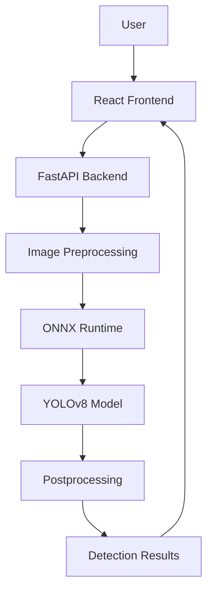

---

## 📸 Görsel Vitrin (Visual Showcase)

### 🛰️ EdgeVision: Havadan Algılama ve Kenar Yapay Zekası
<p align="center">
  
</p>

### 📊 Benchmark ve Performans Analizi
*Edge cihazlarda farklı formatların (FP32, FP16, INT8) performans karşılaştırması.*

<p align="center">
  
  
</p>

### 🎯 Gerçek Tespit Sonuçları (Inference)
*Modelin VisDrone veri seti üzerindeki gerçek tespitleri.*

<p align="center">
  
</p>

### 💻 Web Dashboard ve Arayüz
*React ve TypeScript ile geliştirilen, kullanıcı dostu arayüz.*

<p align="center">
  
</p>

---

# EdgeVision
### Intelligent Aerial Perception & Edge AI Platform

An edge-oriented computer vision platform focused on aerial object detection, deep learning model optimization, and performance evaluation in resource-constrained environments.

<p align="center">

**YOLOv8 | PyTorch | ONNX | FastAPI | React | TypeScript | Docker**

</p>

---

## Overview

EdgeVision is an experimental Edge AI platform designed to investigate the challenges of deploying deep learning-based object detection systems in resource-constrained environments.

The project focuses on aerial imagery and explores the trade-offs between detection accuracy, inference latency, model size, and computational efficiency.

By combining YOLOv8-based object detection models with ONNX deployment configurations, EdgeVision provides an experimental environment for evaluating different model optimization strategies.

### Main Objectives

- Develop an aerial object detection pipeline.
- Evaluate YOLOv8 model architectures.
- Compare FP32, FP16, and INT8 inference configurations.
- Investigate model optimization for edge environments.
- Analyze accuracy, latency, FPS, and model size.
- Provide a web-based interface for inference and visualization.
- Explore hardware-aware deployment strategies.

---

## Key Features

| Feature | Description |
|---|---|
| Object Detection | YOLOv8-based object detection |
| Model Conversion | PyTorch to ONNX |
| Precision Evaluation | FP32, FP16, and INT8 |
| Performance Benchmarking | FPS and inference latency |
| Image Processing | Computer vision preprocessing and postprocessing |
| REST API | FastAPI-based backend |
| Web Interface | React and TypeScript |
| Containerization | Docker-based deployment |

---

## System Architecture

EdgeVision follows a modular client-server architecture.



### Technology Stack

| Component | Technology |
|---|---|
| Programming Language | Python |
| Deep Learning | PyTorch |
| Object Detection | YOLOv8 |
| Computer Vision | OpenCV |
| Model Format | ONNX |
| Inference Runtime | ONNX Runtime |
| Backend | FastAPI |
| Frontend | React, TypeScript |
| Deployment | Docker, Docker Compose |

---

## Model Performance & Benchmarking

A major part of EdgeVision is the evaluation of different model configurations.

The experiments investigate the effects of model architecture and numerical precision on inference performance.

### CPU Benchmark Results

The following results were obtained using a single-thread CPU edge simulation.

| Model | FP32 FPS | FP16 FPS | INT8 FPS |
|---|---:|---:|---:|
| YOLOv8n | 7.25 | 8.93 | 1.23 |
| YOLOv8s | 2.81 | 2.82 | 0.43 |

### Accuracy Evaluation

| Model | Format | mAP50 |
|---|---|---:|
| YOLOv8n | FP32 | 0.2658 |
| YOLOv8n | FP16 | 0.2655 |
| YOLOv8n | INT8 | 0.2545 |
| YOLOv8s | FP32 | 0.3523 |
| YOLOv8s | INT8 | 0.3401 |

### Experimental Findings

**1. FP16 Optimization**

FP16 achieved higher inference throughput than FP32 for YOLOv8n in the reported CPU experiment.

**2. INT8 Quantization**

INT8 reduced model size considerably, but the current implementation did not produce a speed improvement on the tested CPU configuration.

**3. Accuracy vs. Efficiency**

YOLOv8s achieved higher mAP50 than YOLOv8n, while requiring more computational resources.

**4. Deployment Considerations**

Model size reduction does not necessarily translate into lower inference latency. Optimization strategies must be evaluated on the target hardware.

> **Benchmarking disclaimer:** These measurements were obtained through single-thread CPU simulation. They are not Jetson Orin Nano hardware measurements. Actual edge-device performance remains subject to hardware validation.

---

## Small Object Detection

Aerial imagery introduces additional challenges due to object scale, image resolution, and scene density.

Current experiments indicate a significant performance gap between large and small object detection.

| Object Category | mAP50 |
|---|---:|
| Large Objects | 0.535 |
| Small Objects | 0.168 |

Potential improvement strategies include:

- Higher input image resolution.
- Small-object-oriented data augmentation.
- SAHI-based sliced inference.
- Adaptive image tiling.
- P2 detection heads.
- Improved postprocessing and NMS strategies.

These approaches are planned for further experimentation.

---

## Project Structure

The repository is organized into separate components for model development, inference, frontend visualization, and experimental results.

```text
EdgeVision/
├── frontend/
├── models/
├── results/
├── src/
├── tests/
├── ARCHITECTURE.md
├── GETTING_STARTED.md
├── Dockerfile
├── docker-compose.yml
├── requirements.txt
├── README.md
└── README.tr.md
```

---

## Getting Started

### Prerequisites

- Git
- Docker
- Docker Compose
- Python (for model download and auxiliary scripts)

### 1. Clone the Repository

```bash
git clone https://github.com/almina-nur/EdgeVision.git
cd EdgeVision
```

### 2. Download Models

```bash
python download_models.py
```

### 3. Build and Run

```bash
docker compose up --build
```

### 4. Access the Application

| Service | Address |
|---|---|
| Frontend | http://localhost:3000 |
| Backend API | http://localhost:8000 |
| API Documentation | http://localhost:8000/docs |
| Health Endpoint | http://localhost:8000/health |

To stop the application:

```bash
docker compose down
```

---

## Experimental Limitations

EdgeVision is an ongoing research and engineering project.

The current experimental scope has several limitations:

- Edge performance measurements are based on CPU simulation.
- Jetson Orin Nano hardware validation has not yet been completed.
- Current INT8 inference performance requires further optimization.
- Small-object detection remains a significant challenge.
- Real-world performance may differ depending on hardware, runtime, preprocessing, and postprocessing overhead.

These limitations are important considerations for interpreting the reported results.

---

## Development Roadmap

- [ ] Validate inference performance on actual edge hardware.
- [ ] Integrate NVIDIA TensorRT.
- [ ] Evaluate FP16 GPU inference.
- [ ] Implement calibrated static INT8 quantization.
- [ ] Improve small-object detection performance.
- [ ] Investigate adaptive tiling and SAHI.
- [ ] Optimize preprocessing and postprocessing.
- [ ] Improve asynchronous inference architecture.
- [ ] Expand automated testing.
- [ ] Introduce experiment tracking with MLflow.
- [ ] Improve Docker security and deployment reliability.
- [ ] Develop reproducible hardware benchmarks.

---

## Documentation

- [Architecture](ARCHITECTURE.md)
- [Getting Started](GETTING_STARTED.md)
- [Turkish Documentation](README.tr.md)

---

## Project Focus

EdgeVision aims to explore practical engineering challenges in Edge AI and aerial computer vision.

Its primary focus areas are:

- Deep learning-based object detection.
- Model compression and optimization.
- Hardware-aware inference.
- Accuracy-latency trade-offs.
- Edge deployment.
- Reproducible benchmarking.

---

## License

See the repository's LICENSE file for licensing information.

---

<p align="center">

**EdgeVision**

Intelligent Aerial Perception & Edge AI Platform

*Exploring efficient computer vision at the edge.*

</p>


## Roadmap (Planned)
- [ ] MLflow and PostgreSQL integration (code exists, docker-compose ready)
- [ ] TensorRT testing on actual Jetson hardware
- [ ] Static INT8 quantization (QDQ format)
