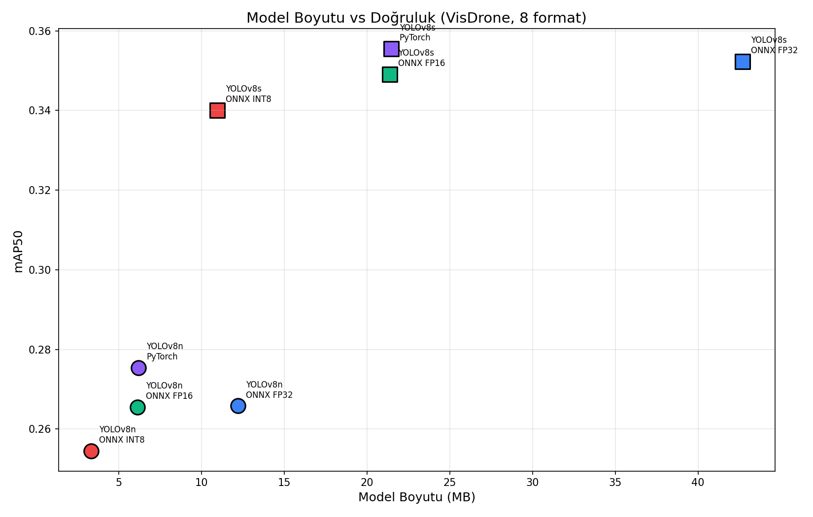
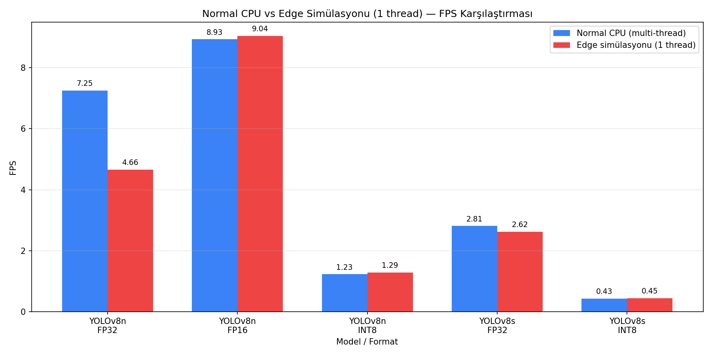
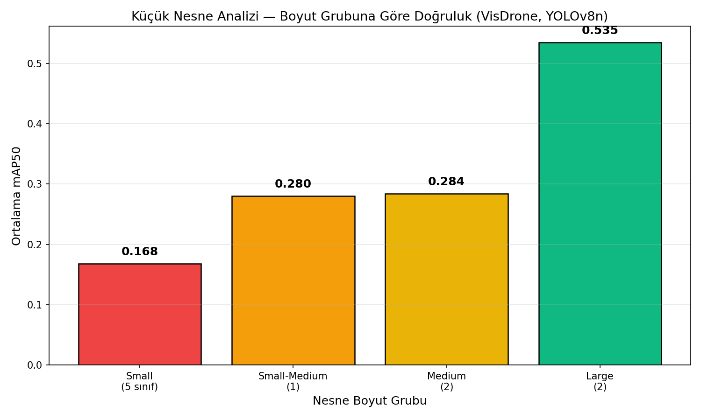

# EdgeVision

IHA goruntulerinde nesne tespiti yapan, uc cihazlarda calisacak sekilde optimize edilmis bir Edge AI platformu.

## Proje Ozeti

Bu proje, VisDrone veri seti uzerinde YOLOv8n ve YOLOv8s modellerini egitip, bu modelleri dort farkli formatta (PyTorch, ONNX FP32, ONNX FP16, ONNX INT8) karsilastirir. Amac, uc cihazlarda (edge) hangi model ve format kombinasyonunun en verimli oldugunu olcmektir.

Proje yalnizca bir YOLO egitimi degildir. Gercek zamanli video cikarimi, edge cihaz simulasyonu, kucuk nesne analizi, isik kosullari analizi, FastAPI backend ve React dashboard icerir.

## Temel Bulgu

YOLOv8n FP16 modeli, edge simulasyonunda (1 CPU thread) FP32 modelinden 2 kat daha hizli ve cok daha stabil calisir:

| Format | Boyut | FPS | P95 Gecikme | mAP50 |
|---|---|---|---|---|
| FP32 | 12.19 MB | 4.66 | 737.8 ms | 0.2658 |
| FP16 | 6.13 MB | 9.04 | 123.2 ms | 0.2655 |
| INT8 | 3.32 MB | 1.29 | 1300.7 ms | 0.2545 |

FP16, dogruluk kaybi olmadan boyutu yariya indirir, hizi 2 kat artirir ve gecikmeyi stabil hale getirir.

## Karsilastirma Tablosu

| Model | Format | Boyut (MB) | mAP50 | FPS (CPU) | FPS (Edge) |
|---|---|---|---|---|---|
| YOLOv8n | PyTorch | 6.18 | 0.2754 | - | - |
| YOLOv8n | ONNX FP32 | 12.19 | 0.2658 | 7.25 | 4.66 |
| YOLOv8n | ONNX FP16 | 6.13 | 0.2655 | 8.93 | 9.04 |
| YOLOv8n | ONNX INT8 | 3.32 | 0.2545 | 1.23 | 1.29 |
| YOLOv8s | PyTorch | 21.46 | 0.3555 | - | - |
| YOLOv8s | ONNX FP32 | 42.69 | 0.3523 | 2.81 | 2.62 |
| YOLOv8s | ONNX FP16 | 21.38 | 0.3491 | 2.82 | - |
| YOLOv8s | ONNX INT8 | 10.96 | 0.3401 | 0.43 | 0.45 |

## Bilimsel Bulgular

1. FP16, edge cihazda FP32'den 2 kat hizli. Edge simulasyonunda 9.04 FPS vs 4.66 FPS. P95 gecikme 123 ms vs 737 ms.
2. INT8, VNNI komut seti olmayan CPU'larda yavaslatiyor. YOLOv8n 7.25 FPS'ten 1.23 FPS'e dusuyor.
3. Quantization kaybi model boyutuna gore degisiyor. YOLOv8n INT8 kaybi %7.6, YOLOv8s INT8 kaybi %4.3.
4. Kucuk nesneler VisDrone'da hala zayif. Buyuk nesnelerde mAP50 0.535, kucuk nesnelerde 0.168.
5. VisDrone'un yarisi zorlu isik kosullarinda. 548 goruntunun 272'si alacakaranlik, 254'u gunduz, 22'si gece.

## Gorseller

Model boyutu ve dogruluk iliskisi:


Normal CPU ve edge simulasyonu karsilastirmasi:


Kucuk nesne analizi:


## Hizli Baslangic

Docker ile calistirma:

```bash
git clone https://github.com/KULLANICI_ADIN/EdgeVision.git
cd EdgeVision
docker compose up --build
```
