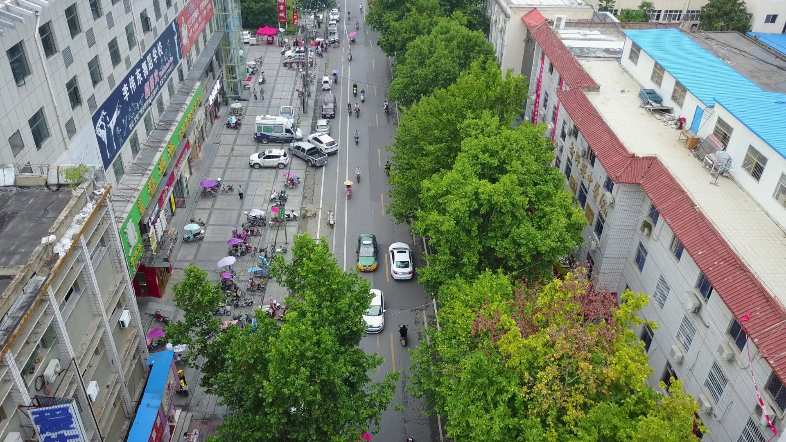
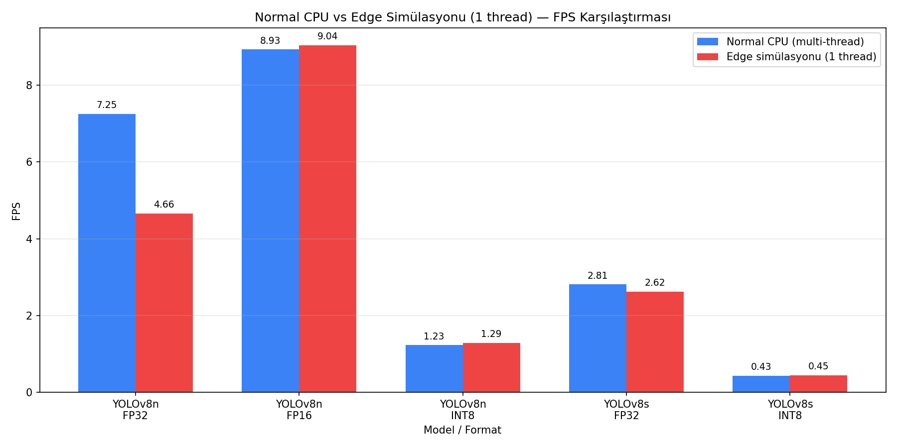
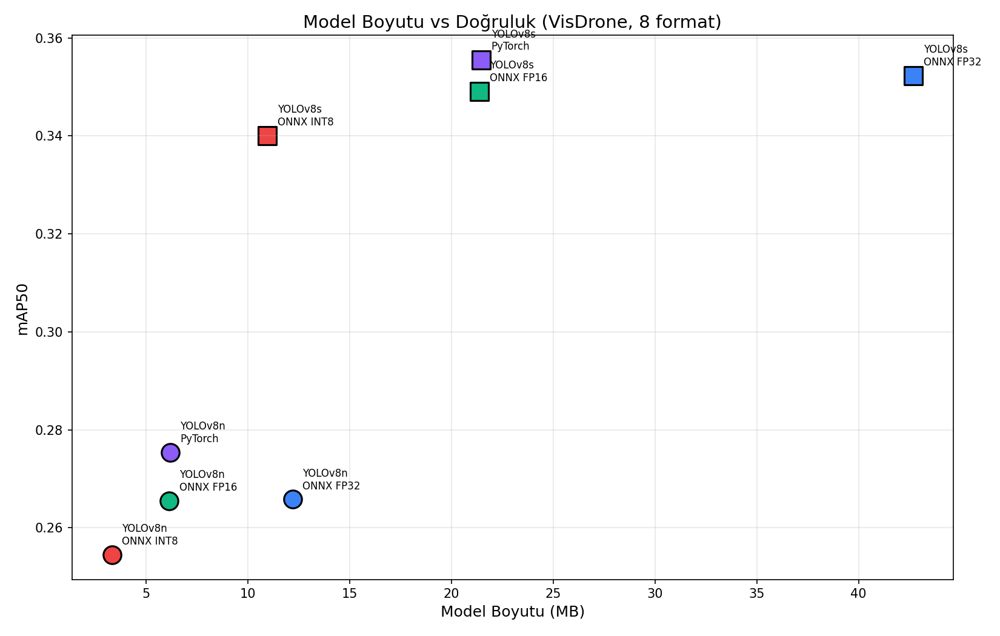
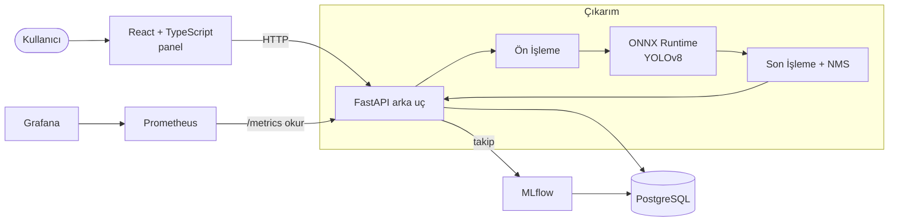

<div align="center">

# 🛰️ EdgeVision

**Havadan küçük nesne tespiti, kenar cihazlar için dürüstçe test edildi.**

YOLOv8 · ONNX (FP32 / FP16 / INT8) · FastAPI · React + TypeScript · PostgreSQL · MLflow · Prometheus

[](LICENSE)




</div>

---

## Bu proje neden var?

Bir iş istasyonu GPU'sunda iyi sonuç veren bir model, kaynak kısıtlı bir cihazda genellikle çöküşe uğrar: daha düşük FPS, istikrarsız gecikme, daha yüksek bellek kullanımı ve küçük, uzaktaki nesnelerin gözden kaçması. Bu özellikle drone görüntüleri için geçerlidir.

EdgeVision, bu uçurumun mühendislik odaklı bir incelemesidir. Sadece [VisDrone](https://github.com/VisDrone/VisDrone-Dataset) üzerinde mAP kovalamak yerine, **doğruluk, gecikme, FPS ve model boyutunu bir arada** ölçer, model varyantları ve sayısal hassasiyetler arasında karşılaştırma yapar ve olumsuz sonuçları da raporlar.

## ✨ Öne Çıkanlar

| | |
|---|---|
| 🎯 **Tespit** | VisDrone üzerinde eğitilmiş YOLOv8n / YOLOv8s |
| ⚙️ **Dışa Aktarma & Niceleme** | PyTorch → ONNX FP32, FP16 ve INT8 (dinamik) |
| 📊 **Kıyaslama** | Format başına mAP50, FPS, gecikme ve bellek; sınıf düzeyi ve ışık koşulu analizleri |
| 🌐 **Web Paneli** | Görsel yükleyin, tuvale çizilen kutuları görün, kıyaslama tablolarına göz atın |
| 🔌 **REST API** | Etkileşimli dokümantasyon ve sağlık uç noktası içeren FastAPI servisi |
| 🧪 **MLOps Altyapısı** | Deney takibi için PostgreSQL + MLflow |
| 📈 **Gözlemlenebilirlik** | Prometheus `/metrics` uç noktası ve Grafana paneli |
| 🐳 **Tek Komutla Dağıtım** | Tüm yığın için Docker Compose |

## 🚀 Hızlı Başlangıç

**Gereksinimler:** Git, Compose içeren Docker ve Python 3 (sadece model indirme betiği için).

```bash
# 1. Klonlayın
git clone https://github.com/almina-nur/EdgeVision.git
cd EdgeVision

# 2. Sırları yapılandırın (.env dosyasını asla commit'lemeyin)
cp .env.example .env        # ardından şifreleri düzenleyin

# 3. v0.1.0 sürümünden eğitilmiş modelleri indirin
python download_models.py

# 4. Her şeyi başlatın
docker compose up --build
```

| Servis | URL |
|---|---|
| Panel (Dashboard) | http://localhost:3000 |
| API | http://localhost:8000 |
| API dokümanları (Swagger) | http://localhost:8000/docs |
| Sağlık Durumu | http://localhost:8000/health |
| Metrikler | http://localhost:8000/metrics |
| MLflow | http://localhost:5000 |
| Prometheus | http://localhost:9090 |
| Grafana | http://localhost:3001 |

Durdurmak için `docker compose down` (birimleri de silmek için `-v` ekleyin).

<details>
<summary><b>Yapılandırma</b></summary>

| Değişken | Amaç | Varsayılan |
|---|---|---|
| `MODEL_PATH` | API tarafından sunulan ONNX modeli | `models/yolov8n_fp16.onnx` |
| `DATABASE_URL` | PostgreSQL bağlantı dizesi | `.env` üzerinden oluşturulur |
| `MLFLOW_TRACKING_URI` | MLflow takip sunucusu | `http://mlflow:5000` |
| `POSTGRES_PASSWORD` | Veritabanı şifresi | **gerekli** |
| `GRAFANA_PASSWORD` | Grafana yönetici şifresi | **gerekli** |

VisDrone veri setini de indirmek için: `python download_models.py --all`

</details>

## 📊 Sonuçlar

> ⚠️ **Önce bunu okuyun.** Tüm hız verileri **tek iş parçacıklı CPU simülasyonundan** elde edilmiştir, Jetson Orin Nano donanımından değil. Formatlar arası *göreceli* davranışı gösterirler, mutlak kenar cihaz performansını değil. Donanım doğrulaması [yol haritasında](#-yol-haritası).

<table>
<tr>
<td width="50%"></td>
<td width="50%"></td>
</tr>
</table>

| Model | Format | Boyut (MB) | mAP50 | FPS (CPU) | FPS (1 iş parçacığı) |
|---|---|---:|---:|---:|---:|
| YOLOv8n | PyTorch | 6.18 | 0.2754 | – | – |
| YOLOv8n | ONNX FP32 | 12.19 | 0.2658 | 7.25 | 4.66 |
| YOLOv8n | ONNX FP16 | 6.13 | 0.2655 | 8.93 | 9.04 |
| YOLOv8n | ONNX INT8 | 3.32 | 0.2545 | 1.23 | 1.29 |
| YOLOv8s | PyTorch | 21.46 | 0.3555 | – | – |
| YOLOv8s | ONNX FP32 | 42.69 | 0.3523 | 2.81 | 2.62 |
| YOLOv8s | ONNX FP16 | 21.38 | 0.3491 | 2.82 | – |
| YOLOv8s | ONNX INT8 | 10.96 | 0.3401 | 0.43 | 0.45 |

### Neler öğrendik? (ve nelerin daha fazla doğrulanması gerekiyor?)

1. **CPU üzerinde FP16 vs FP32 durumu karmaşıktır.** İlk 1 iş parçacıklı testlerde YOLOv8n FP16 için umut vaat eden 2 kat hızlanma görülse de, bu sonuç model boyutları arasında ciddi farklılık göstermektedir (örneğin, YOLOv8s hiçbir hızlanma göstermemiştir). Bu durum, olası ölçüm gürültüsüne veya CPU tarafındaki FP16 yürütme kısıtlamalarına (ONNX Runtime genellikle FP16'yı FP32'ye geri dönüştürür) işaret eder. Kesin sonuçlara varmadan önce titiz bir doğrulama (n=30+ tekrar, p95/p99 gecikme) gereklidir. Gerçek FP16 kazanımları GPU/TensorRT üzerinde beklenmektedir.
2. **INT8, Statik Niceleme gerektirir.** Dinamik INT8 niceleme, model boyutunu ~%72 küçültür ancak CPU'da çıkarımı önemli ölçüde yavaşlatır. Bu beklenen bir durumdur: dinamik niceleme, Evrişimli Sinir Ağları (CNN) için değil, MatMul/LSTM işlemleri için optimize edilmiştir. YOLO için doğru yaklaşım, temsili bir kalibrasyon veri seti ile **Statik PTQ (QDQ formatı)** ve nihayetinde GPU'da (örneğin Jetson Orin Nano) TensorRT INT8'dir.
3. **Küçük nesneler hala darboğazdır.** Büyük nesneler için mAP50 **0.535** iken, küçük nesneler için bu değer sadece **0.168**'dir. SAHI (Döşemeli Çıkarım) potansiyel bir çözüm olsa da, gecikme maliyeti (çıkarım süresini döşeme sayısıyla çarpması) katı kenar cihaz bütçelerine karşı değerlendirilmelidir. Daha yüksek giriş çözünürlüğü (960px) ve uyarlanabilir döşeme gibi alternatifler planlanmaktadır.

Sınıf düzeyi ve ışık koşulu analizleri [`results/`](results/) dizininde bulunmaktadır.

## 🏗️ Mimari



### Depo Yapısı

```text
EdgeVision/
├── src/
│   ├── train.py              # eğitim
│   ├── export_onnx.py        # ONNX dışa aktarma + niceleme
│   ├── inference.py          # tekli görsel çıkarımı
│   ├── video_inference.py    # video tespiti + FPS
│   ├── benchmark.py          # FPS / gecikme / bellek
│   └── api/main.py           # FastAPI servisi
├── frontend/                 # React + TypeScript paneli
├── mlflow/                   # MLflow imajı (PostgreSQL sürücüsü ekler)
├── models/                   # indirilen ağırlıklar (git tarafından yok sayılır)
├── results/                  # CSV sonuçları ve grafikler
├── assets/                   # README görselleri
├── tests/
├── docker-compose.yml
├── prometheus.yml
├── download_models.py
└── ARCHITECTURE.md
```

Dosya bazında açıklamalar için [ARCHITECTURE.md](ARCHITECTURE.md) ve daha detaylı bir rehber için [GETTING_STARTED.md](GETTING_STARTED.md) dosyalarına bakın.

## ⚠️ Bilinen Sınırlamalar

- Hız sonuçları CPU simülasyonlarıdır, Jetson Orin Nano ölçümleri **değildir**.
- INT8 modelleri dinamik niceleme kullanır ve şu anda çıkarımı *yavaşlatmaktadır*.
- SAHI / döşemeli çıkarım henüz API'ye entegre edilmemiştir.
- Henüz TensorRT veya GPU kıyaslamaları yoktur.
- Sadece YOLOv8n ve YOLOv8s değerlendirilmiştir.

## 🗺️ Yol Haritası

**Tamamlananlar**
- [x] VisDrone üzerinde YOLOv8n/s eğitimi
- [x] FP32, FP16 ve INT8 formatlarında ONNX dışa aktarma
- [x] Sınıf düzeyi ve ışık analizi içeren kıyaslama paketi
- [x] FastAPI servisi ve React paneli
- [x] Docker Compose dağıtımı

**Sıradakiler**
- [ ] Gerçek Jetson Orin Nano donanımında kıyaslama (güç ve sıcaklık dahil)
- [ ] TensorRT FP16 ve kalibre edilmiş INT8
- [ ] Baş katmanları hariç tutularak statik INT8 niceleme (QDQ)
- [ ] Her kıyaslama çalışmasını MLflow'a kaydetmek (parametreler, metrikler, eserler)
- [ ] Doğruluk-gecikme Pareto eğrisi ile SAHI / uyarlanabilir döşeme
- [ ] Küçük nesneler için daha yüksek giriş çözünürlüğü ve P2-başlık ablasyonları
- [ ] Çıkarımı olay döngüsünden ayırmak (işçi havuzu) ve yük testleri eklemek
- [ ] CI: lint, tip kontrolü, testler, imaj taraması ve niceleme kalite kapısı

## 🤝 Katkıda Bulunma

Sorunlar ve pull request'ler memnuniyetle karşılanır. Daha büyük değişiklikler için lütfen önce bir sorun (issue) açın.

## 📄 Lisans

[MIT Lisansı](LICENSE) altında yayınlanmıştır.

## 🙏 Teşekkürler

[Ultralytics YOLOv8](https://github.com/ultralytics/ultralytics) · [VisDrone veri seti](https://github.com/VisDrone/VisDrone-Dataset) · [ONNX Runtime](https://onnxruntime.ai/)
